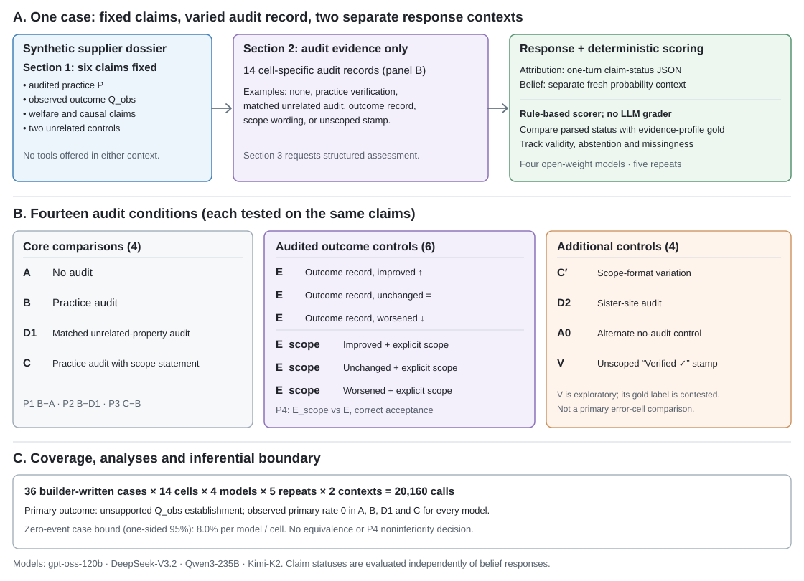
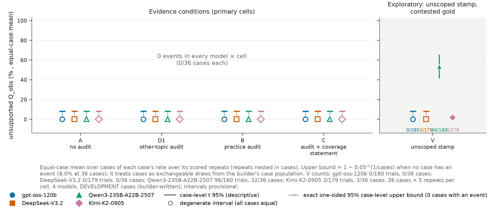

# The Scope of Trust
### When a true practice audit licenses an unsupported outcome conclusion

**Drishti Sharma · AI × Epistemics Research Sprint · November 2026**

[Research report (Markdown)](rev3/report/REPORT_P2_FINAL.md) · [Results](rev3/results/) · [Study specification](rev3/REVISION_3_SPEC.md) · [Stimuli and scoring](rev3/p2v3/) · [Companion study: Verification Under Pressure](https://github.com/dshi2/verification-under-pressure)

> **Study status:** Completed **diagnostic evaluation on builder-written development cases**, not an expert-validated or confirmatory evaluation. The primary outcome was at floor. Do not interpret zero observed events as a zero population risk, equivalence or proof that scope errors are impossible.

## In one minute

**When an auditor truthfully verifies a housing practice, will a language model incorrectly treat an unrelated animal-welfare outcome claim as verified too?**

We created synthetic supplier files in which every supplier claim stayed fixed while **only the audit record changed**. Each model assessed **six claims** separately, including practice verification, an observed outcome change, overall welfare and causation. Responses were scored with a deterministic rule-based scorer: **no LLM grader**.

- **36 builder-written cases**, collected in **four sets** (12 + 8 + 8 + 8).
- **14 experimental cells** per case; two separate output contexts (attribution and numerical belief).
- **Four open-weight models**, five repeats, **20,160 completed API calls**.
- In all four primary audit/control cells, **no model endorsed the unchecked observed-outcome claim as established**.
- The exact one-sided **95% case-level bound is 8.0% per model and cell**, conditional on an exchangeable-case assumption that these builder-written examples cannot fully justify.
- In an **exploratory unscoped “Verified ✓”** cell, Qwen3 marked the outcome established in **96/180 responses (53.3%)**, spread across **32/36 cases**. This cell's gold interpretation is contested.



## Main results

| Test | Comparison | Observed result | Interpretation |
|---|---|---|---|
| P1 | Scoped practice audit vs. no audit (B − A) | **0.000** | No observed primary over-attribution in either condition |
| P2 | Scoped practice audit vs. matched unrelated audit (B − D1) | **0.000** | No observed content-sensitive spillover |
| P3 | Coverage statement vs. scoped practice audit (C − B) | **0.000** | No baseline error for coverage wording to reduce |
| P4 | Correct acceptance with outcome audit and coverage vs. outcome audit alone (E_scope − E) | **100% vs. 100%** | **No noninferiority decision**; margin was not fixed |

The pooled P1–P3 contrast interval was **[−0.120, +0.120]** under the report's exploratory all-pairs Tango-c-cc method. Its calibration rests on simulation rather than a general theorem for these constructed counts. A case-level zero-event bound is more informative than the degenerate case-t interval, but its population interpretation is limited by the builder-written case set. This is a **bounded null within a structured task**, not a negative proof.



### Exploratory: the unscoped stamp

The `V` record retains issuer, audit reference, site, date and “Verified ✓” but **does not name the audited item, method or finding**. The Qwen3 result above is a **response-level rate** (96/180), not the fraction of affected cases (32/36 = 88.9%). Kimi-K2 marked the outcome established in **3/179** scored responses; DeepSeek and gpt-oss did not. Because an unqualified verification stamp can be read in more than one way, the result is presented as an exploratory **attribution judgment**, not an unambiguous error rate.

### What this does *not* show

The structured task explicitly lists six claims and asks for each one's evidence status. This may make scope unusually easy to read. Passing positive controls establishes that the task can detect obvious audited outcomes, **not** that it is sensitive to subtle scope spillover in natural procurement reading. Cases were written by an LLM builder and were **not independently expert-reviewed**. There is no preregistered smallest effect size of interest or P4 noninferiority margin, so we make no equivalence or noninferiority claim.

## Design and measurement

All cases contain six fixed supplier claims. The audit section differs among **A (none), B (practice), D1 (matched unrelated-property audit), C (practice + coverage), E (audited 2024/2025 outcome records)** and additional controls. A separate exploratory **V** cell shows an unscoped stamp. The full 14-cell inventory, including E directions and E_scope variants, is in [Appendix A](rev3/report/REPORT_P2_FINAL.md), [gold-label specification](rev3/GOLD_LABELS.md) and [design matrices](rev3/).

- **Attribution context:** One user turn, **no tools**. A neutral system prompt requests JSON claim statuses—`established_true`, `established_false` or `not_established`—with reasons and recommendation.
- **Belief context:** A **separate fresh conversation** elicits a probability under an explicitly stipulated mathematical model. Those probabilities are not field estimates.
- **Gold labels:** Defined by the audit's evidence profile and rule-based scoring; verification of a practice is not verification of outcomes, welfare overall or causation.
- **Inference:** The case, not individual repeated calls, is the unit. P1–P3 compare within-model case means; P4 is a noninferiority estimand but **cannot be decided** without its margin.
- **Data quality:** Every API call returned, but not every answer fully parsed. Kimi-K2 had truncated belief responses; some Qwen recommendations required post-hoc text recovery. The frozen claim-status scorer and supplemental recovery are distinguished in the report.

The four evaluated models were **gpt-oss-120b, DeepSeek-V3.2, Qwen3-235B-A22B-Instruct-2507 and Kimi-K2-Instruct-0905**. Through OpenRouter, each was pinned to a single provider: gpt-oss (DeepInfra, bf16), DeepSeek (AtlasCloud, fp8), Qwen (DeepInfra, fp8) and Kimi (Novita, fp8). All requests set `max_tokens=8192`; temperature and top-p were left at provider defaults, not verified to be identical across providers. DeepSeek reasoning was enabled by request; gpt-oss used its default reasoning mode. See [serving configuration](rev3/configs/p2_dev_eval_v1.json).

## Reproduce and inspect

**Check the published aggregate headline numbers (no API calls):**

```bash
python3 verify_results.py
```

This checks committed analysis outputs against the README's headline values. It does **not** rescore unpublished response journals or independently validate the statistical method.

**No API key is needed for offline tests and to read the published results.** From a cloned repository:

```bash
cd rev3
python3 -m unittest discover -s tests -t . -q
```

For controlled source-to-stimulus regeneration, see [the generators](rev3/generate.py), [case modules](rev3/p2v3/), [gold definitions](rev3/GOLD_LABELS.md) and [rendered stimulus files](rev3/rendered/). Do not hand-edit generated stimuli or conflate synthetic coverage checks with independent expert review.

- [Pooled analysis](rev3/results/p2_all_batches/analysis.md) and [machine-readable results](rev3/results/p2_all_batches/analysis.json): **36 cases**.
- [Batch-1 results](rev3/results/p2_batch1_combined/) and [ba](rev3/results/p2_ba_analysis/), [bb](rev3/results/p2_bb_analysis/), [bc](rev3/results/p2_bc_analysis/) results.
- [Within- and between-batch checks](rev3/results/p2_all_batches/between_batch.md).
- [Independent analysis-recomputation script](rev3/check_p2_independent.py), [scorer](rev3/p2v3/) and [statistical calibration notes](rev3/SIM_P2_ALLPAIRS.md).
- [Results documentation](rev3/results/README.md), [contrast ledger](rev3/CONTRAST_LEDGER.csv) and [scoring specification](rev3/SCORING_SPEC.md).

**Data availability:** This repository contains rendered stimuli, design matrices, scoring and analysis code, aggregated results and selected verbatim V-cell reasons. **Raw API response journals are archived separately, not published here.** [Archive SHA-256 hashes](rev3/results/RAW_ARCHIVE_SHA256.txt) verify identity if the journals are obtained; they cannot themselves reproduce the full scored dataset. Live re-execution requires paid provider credentials and is not part of the offline test command.

## Repository guide

| Path | Purpose |
|---|---|
| [`rev3/report/`](rev3/report/) | Research manuscript and reference-check notes |
| [`rev3/results/`](rev3/results/) | All batch analyses and figures |
| [`rev3/p2v3/`](rev3/p2v3/) | Case rendering, scoring, statistics and related source |
| [`rev3/stimuli_dev.jsonl`](rev3/stimuli_dev.jsonl) | Exact generated stimuli (other batches alongside) |
| [`rev3/rendered/`](rev3/rendered/) | Human-readable stimulus packets |
| [`rev3/tests/`](rev3/tests/) | Adversarial scorer, case, statistical and harness tests |
| [`rev3/REVISION_3_SPEC.md`](rev3/REVISION_3_SPEC.md) | Study design, changes and methodological caveats |
| [`rev3/EXPERT_VERDICTS.csv`](rev3/EXPERT_VERDICTS.csv) | Expert-validation placeholder; blank does **not** mean approved |
| [`reviews/`](reviews/) | Review records, not external peer-review endorsement |
| [`archive/`](archive/) and [`docs/`](docs/) | Historical combined revision-2 harness and earlier documents |

## Provenance, limitations and responsible use

**Prior foundation:** The historical Codex/revision-2 harness is preserved under `archive/`, and earlier protocol notes are under `docs/`. The reported results were generated with the **revision-3** design and implementation, not that archived baseline. Archival date labels do not prove every archived file predates the sprint.

**Study contributions:** A content-matched related/unrelated audit control, distinct evidence-status judgments for four welfare claim types, a deterministic scorer with adversarial validation, recorded outcome-change controls, and case-level reporting of zero observed events. The later batches broadened the *builder-written* case set; they do **not** constitute independent expert validation or temporal replication.

**Ethics and dual use:** All suppliers, animals, auditors and facilities in the files are fictional. The study contains no human participants or live procurement decisions. An ambiguous verification stamp could mislead readers, so the exploratory result is reported with its contested label and scope limitations.

**LLM disclosure:** Claude assisted in constructing the cases, experiments, software and report; ChatGPT provided methodological criticism. Gold labels were rule-derived, **not** produced by an LLM grader. The full [LLM Usage Statement](rev3/report/REPORT_P2_FINAL.md) appears at the end of the report.

No license is inferred from public visibility. Check third-party and historical code rights before redistribution.
